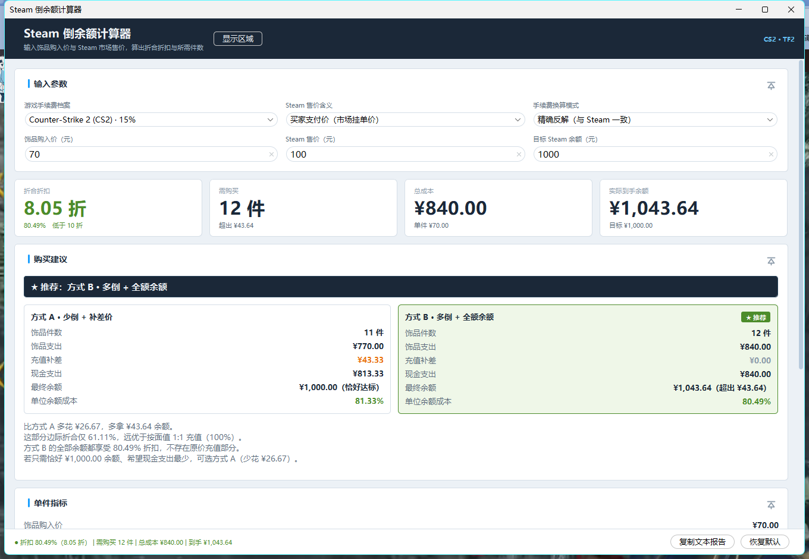
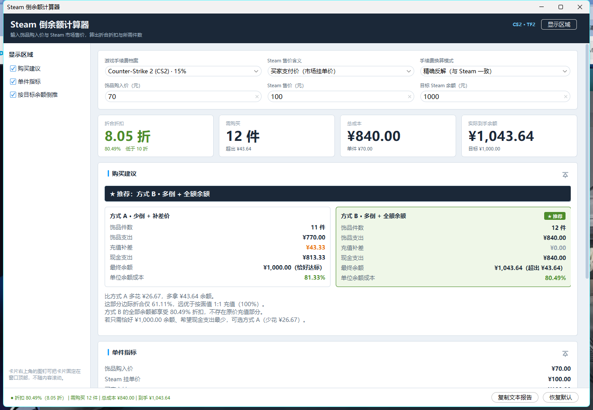
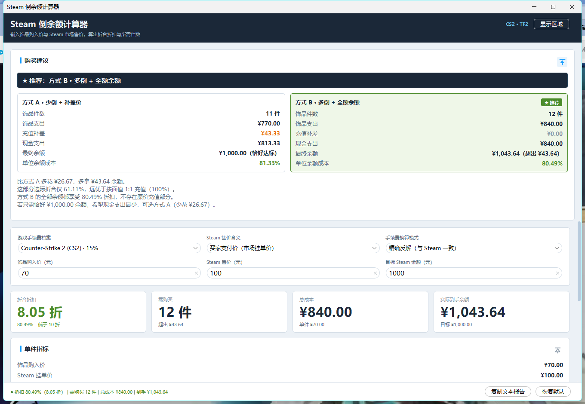
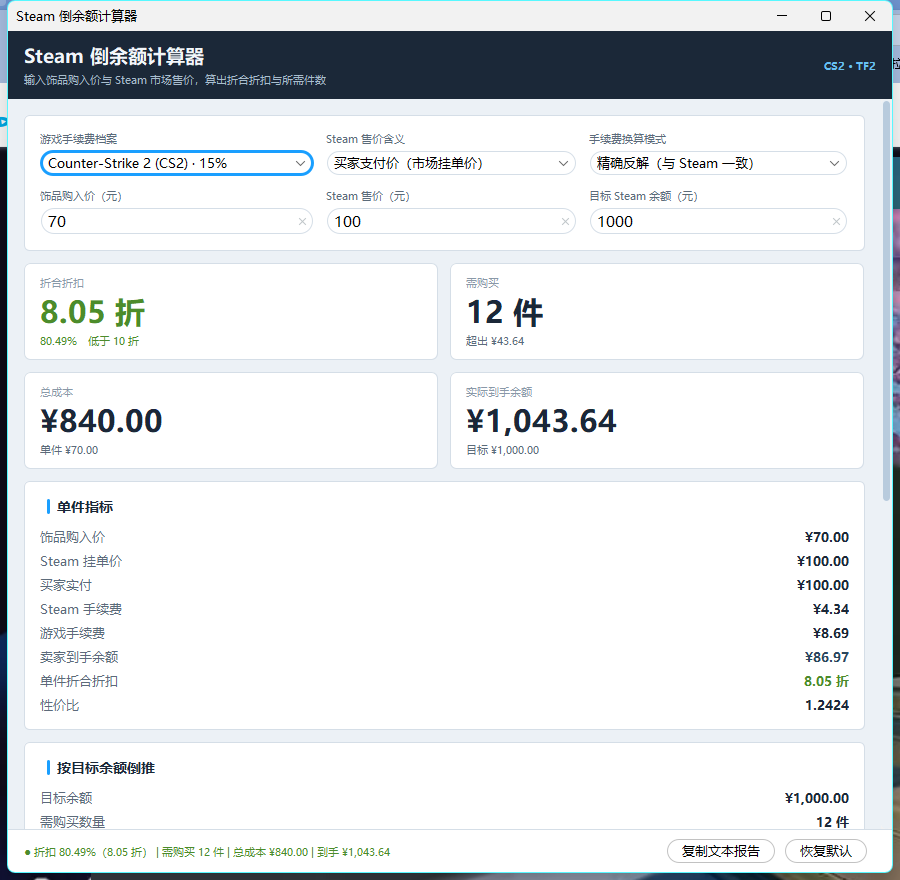

# Steam 倒余额计算器

用 Java 写的 Steam「倒余额」计算器：输入饰品在第三方平台（BUFF、悠悠有品等）的**购入价**
与在 Steam 社区市场的**售价**，输出**折合折扣**、为拿到目标 Steam 余额**需要买几件**，
并在「少倒 + 补差价」与「多倒 + 全额余额」两种买法之间**给出推荐**。



- **编译期零依赖**：只要 JDK 就能 `javac` 编译，不需要 Maven / Gradle
- 命令行与 Swing 图形界面两条入口，共用同一套算法，数字完全一致
- 界面可选启用 [FlatLaf](https://www.formdev.com/flatlaf/) 现代外观，缺失时自动回退系统外观
- 手续费按游戏配置，内置 **CS2** 与 **TF2**
- 金额全程按「分」做整数运算，不出现 `double`——浮点误差足以让「需购买件数」整整差一件

---

## 一、环境要求与依赖

**JDK 17 或更高**（本项目在 OpenJDK 25.0.2 上编译运行，源码以 `--release 17` 校验兼容性）。

依赖分两层，这样「克隆下来就能编译」永远成立：

| 层 | 依赖 | 说明 |
|---|---|---|
| 编译期 | **无** | `javac` 只需要 JDK。FlatLaf 通过 `UIManager.setLookAndFeel(类名)` 反射加载，源码里不出现任何第三方类型 |
| 运行期 | 可选 FlatLaf | 只影响图形界面观感。`.\download-deps.ps1` 自动下载到 `lib\`（自动探测系统代理、幂等）；没有它时回退系统外观，功能完全一致 |

`lib\` 已在 `.gitignore` 中，仓库不放二进制；`run-gui.ps1` 首次运行会自动拉取一次。

---

## 二、快速开始

```powershell
# 交互模式（首次使用推荐）
.\run.ps1

# 单次计算：BUFF 购入 70 元，Steam 挂单 100 元，想要 1000 元余额
.\run.ps1 --buy 70 --sell 100 --target 1000

# 位置参数写法（依次为 购入价 售价 目标余额）
.\run.ps1 70 100 1000

# 图形界面
.\run-gui.ps1

# 跑自测
.\run-tests.ps1

# 手动拉取可选的界面美化依赖（run-gui.ps1 会自动做，一般不必手动执行）
.\download-deps.ps1
```

`run.ps1` 与 `run-gui.ps1` 会在 `out\classes` 不存在时自动先编译；
`run-gui.ps1` 还会在 `lib\` 为空时自动下载 FlatLaf。
也可以单独执行 `.\build.ps1`。

---

## 三、计算公式

### 1. Steam 市场手续费

Steam 社区市场对每笔成交收取两部分费用，**每项最低 1 分**：

```
Steam 手续费 = max( floor(卖家收入 × 5%),  1分 )
游戏手续费  = max( floor(卖家收入 × 10%), 1分 )
买家支付    = 卖家收入 + Steam 手续费 + 游戏手续费
```

注意方向：**Steam 页面上的挂单价是「买家支付」，卖家到手要减去手续费**。
本工具的默认输入口径就是挂单价，会自动完成这次反推。

反推不是简单除以 1.15。由于每项手续费都要向下取整，`买家支付` 与 `卖家收入` 之间并非一一对应，
存在取不到的「空档位」——例如卖家的 99 分对应买家支付 112 分，而 113、114 分都取不到，
下一档直接跳到 115 分。本工具按 Steam 真实公式逐分反解，因此结果与页面显示一致；
若输入的价格恰好落在空档位上，会给出提示并说明相邻的真实档位。

### 2. 折合折扣

```
单件到手余额 = 挂单价反推得到的卖家收入
折合折扣     = 总成本 ÷ 实际到手余额
```

同时用两种方式表达：百分数（`80.49%`）与中文习惯的「几折」（`8.05 折`）。
数值小于 1（低于 10 折）表示这笔倒余额划算。

### 3. 需购买件数

```
需购买件数   = ⌈ 目标余额 ÷ 单件到手余额 ⌉
总成本       = 需购买件数 × 饰品购入价
实际到手余额 = 需购买件数 × 单件到手余额
```

件数必须**向上取整**：差一分钱也是不够。

---

## 四、手算核对示例

BUFF 购入价 **70.00 元**，Steam 挂单价 **100.00 元**，目标余额 **1000.00 元**，CS2：

| 步骤 | 计算 | 结果 |
|---|---|---|
| 反推卖家收入 | `S + floor(S×5%) + floor(S×10%) ≤ 10000` 的最大 `S` | **8697 分 = ¥86.97** |
| 验算 | `8697 + 434 + 869 = 10000` ✅ 而 `8698 + 434 + 869 = 10001` ❌ | — |
| 单件折合折扣 | `7000 ÷ 8697` | **80.49%（8.05 折）** |
| 需购买件数 | `⌈100000 ÷ 8697⌉ = ⌈11.498⌉` | **12 件** |
| 总成本 | `12 × 70.00` | **¥840.00** |
| 实际到手余额 | `12 × 86.97` | **¥1,043.64** |
| 超出目标 | `1043.64 − 1000.00` | **¥43.64** |

实际运行输出（`.\run.ps1 --buy 70 --sell 100 --target 1000`）：

```
 饰品购入价    : ¥70.00
 Steam 挂单价  : ¥100.00
 买家实付      : ¥100.00
 Steam 手续费  : ¥4.34
 游戏手续费    : ¥8.69
 卖家到手余额  : ¥86.97
 单件折合折扣  : 80.49% （8.05 折，划算）
 性价比        : 1.2424（每花 ¥1 到手 ¥1.2424 余额）

 目标余额      : ¥1,000.00
 需购买数量    : 12 件
 总成本        : ¥840.00
 实际到手余额  : ¥1,043.64
 实际折合折扣  : 80.49% （8.05 折，划算）
 超出目标      : ¥43.64
```

（输出末尾还会打印 `[购买建议]` 章节，对比两种买法并给出推荐，见第五节。）

### 近似模式会差多少

同一笔用 `--fee-mode simple`（直接 `100 ÷ 1.15` 向下取整）会得到 8695 分 = ¥86.95，
比真实值少 2 分。单笔差别不大，但放大到上百件就是几元钱的系统性低估，
所以默认使用精确反解。

---

## 五、购买建议

凑够目标余额有两条路，工具会同时算清楚并把账摆在一起：

| | 方式 A · 少倒 + 补差价 | 方式 B · 多倒 + 全额余额 |
|---|---|---|
| 做法 | 买 `⌊目标 ÷ 单件到手⌋` 件，缺口用真钱**按面值充值**补上 | 多买一件凑够目标 |
| 最终余额 | 恰好等于目标 | 超出目标 |
| 现金支出 | **最少** | 更多 |
| 单位余额成本 | 折扣与面值的加权平均，必然劣于方式 B | **最低**，每分余额都享受折扣 |

### 推荐逻辑

记单件成本 `c`、单件到手 `s`、方式 A 向下取整后的缺口 `r = 目标 − ⌊目标÷s⌋·s`。
两者相比，方式 B 的**边际支出**是 `c − r`，**边际余额**是 `s − r`：

- **`r ≥ c`** ⟹ 边际支出 ≤ 0：方式 B **又省钱又多拿余额**，无条件更优。
  直觉上很好理解——与其原价充 `r` 元，不如拿这笔钱去买一件，还能额外拿到余额。
- **`r < c`** 且单件划算（`c < s`）：方式 B 多掏 `c − r`，换回 `s − r` 余额。
  这个边际折合必然低于 100%，比按面值充值便宜，**仍然推荐方式 B**。
- **单件本身不划算（`c ≥ s`）**：多倒一件只会多亏，改推荐**方式 A**，尽量少倒，
  缺口直接充值。

一句话：**只要倒余额本身是赚的，方式 B 的单位余额成本永远不会比方式 A 差**，
代价只是现金占用更多。方式 A 的价值在于「现金支出最少」和「余额恰好等于目标」。

### 推荐理由长什么样

程序会把结论量化，例如基准算例：

```
 方式 A · 少倒 + 补差价                方式 B · 多倒 + 全额余额
   饰品件数      : 11 件                 饰品件数      : 12 件
   饰品支出      : ¥770.00               饰品支出      : ¥840.00
   充值补差      : ¥43.33                充值补差      : ¥0.00
   现金支出      : ¥813.33               现金支出      : ¥840.00
   最终余额      : ¥1,000.00（恰好达标）  最终余额      : ¥1,043.64（超出 ¥43.64）
   单位余额成本  : 81.33% （8.13 折）     单位余额成本  : 80.49% （8.05 折）

 ★ 推荐：方式 B · 多倒 + 全额余额
   比方式 A 多花 ¥26.67，多拿 ¥43.64 余额，
   这部分边际折合仅 61.11%，远优于按面值 1:1 充值（100%）。
   方式 B 的全部余额都享受 80.49% 折扣，不存在原价充值部分。
   若你只需要恰好 ¥1,000.00 余额、希望现金支出最少，可选方式 A（少花 ¥26.67）。
```

「**边际折合 61.11%**」是这里最有价值的一个数：它衡量的是「多倒一件来替代充值」
这个动作本身——相当于用面值的六成买到余额。

### 几个边界情况

- **目标恰为单件到手的整数倍**：两种方式完全相同，程序直接告诉你「买 N 件即可」，
  不会硬凑出一个需要充值的方案。
- **目标低于单件到手**：方式 A 退化为纯充值（0 件饰品、无任何折扣），
  此时只要单件划算就推荐方式 B。
- **缺口不足 ¥1**：Steam 充值渠道通常有最小金额限制，这种零头往往补不进去，
  程序会提醒你直接多倒一件更省事。

---

## 六、命令行参数

| 参数 | 说明 |
|---|---|
| `--buy <元>` | 饰品购入价（第三方平台单价），**必填** |
| `--sell <元>` | Steam 售价，含义由 `--price-type` 决定，**必填** |
| `--target <元>` | 想要获得的 Steam 余额，**必填** |
| `--game <cs2\|tf2>` | 游戏手续费档案，默认 `cs2` |
| `--price-type <buyer\|seller>` | `buyer`（默认）表示输入的是市场挂单价，程序自动扣手续费；`seller` 表示输入的是卖家到手价，程序不再扣费 |
| `--fee-mode <exact\|simple>` | `exact`（默认）精确反解；`simple` 粗略近似 `售价 ÷ 1.15` |
| `--gui` | 启动图形界面 |
| `-h`, `--help` | 显示帮助 |

- 同时支持 `--key value` 与 `--key=value` 两种写法
- 未使用 `--buy/--sell/--target` 时，位置参数按「购入价 售价 目标余额」顺序填充
- 退出码：`0` 正常，`2` 参数或输入错误

常用组合：

```powershell
# 我只看得到 Steam 的「卖家收入」，直接用它算
.\run.ps1 --buy 70 --sell 86.97 --target 1000 --price-type seller

# TF2 饰品
.\run.ps1 --buy 70 --sell 100 --target 1000 --game tf2
```

---

## 七、图形界面

`.\run-gui.ps1` 启动。三个输入框都装了实时监听，边打字边出结果。


### 界面构成

| 区域 | 内容 |
|---|---|
| 顶部标题栏 | Steam 深蓝 `#1B2838`；标题文字右侧是侧边抽屉开关「显示区域」 |
| 侧边抽屉 | 可折叠（默认收起），三个开关控制下方内容区域的显示 |
| 输入参数卡 | 两行三列，小标签在上、控件在下；下拉框带 tooltip 说明 |
| 核心指标卡 | 折合折扣、需购买、总成本、实际到手余额——**大号数字承载结论**，划算为绿、不划算为红 |
| 内容卡片 | 购买建议 → 单件指标 → 按目标余额倒推；每张卡右上角有图钉按钮 |
| 底部状态栏 | 单行摘要；右侧「复制文本报告」「恢复默认」按钮 |

**四张卡片都带图钉**：输入参数、购买建议、单件指标、按目标余额倒推。
侧边抽屉的三个开关只控制后三块内容，输入区始终显示。

### 内容区域的显示与置顶

三块内容都是独立卡片，可以**单独隐藏**，也可以**单独固定在窗口顶部**；
输入参数卡同样带图钉，方便一边调参数一边看结果。

点标题栏右侧的「显示区域」滑出侧边抽屉：



点卡片右上角的图钉，该卡片就被钉在窗口顶部——**下方内容滚动时它保持可见**：



- 默认顺序为「购买建议 → 单件指标 → 按目标余额倒推」，顺序由 `Section` 枚举决定
- 可以同时钉住多张卡；置顶区最高占窗口高度的 55%，再多则置顶区自身滚动
- 用开关隐藏一张已置顶的卡片时，会同时取消它的置顶，避免它继续占着顶部空间

### 与命令行的一致性

界面不再复刻命令行的等宽文本，而是用结构化组件渲染，因此**中英混排天然对齐**，
不再依赖空格 padding。但两者取数完全同源：

- 折扣格式走 `Formats.discount()`，推荐理由走 `AdviceNarrator.reasons()`，措辞不会分叉
- 「复制文本报告」按钮（或 `Ctrl+D`）会把**与命令行逐字相同**的报告复制到剪贴板

### 响应式与分辨率适配

窗口宽度跨过 **1150px** 时切换核心指标卡的列数：宽屏一行 4 张，窄屏两行 2 张。



窗口初始尺寸按屏幕可用区域的比例计算并限制在屏内，最小尺寸也随屏幕收缩；
内容区可纵向滚动，因此 1366×768 这类小屏不会被撑破。
已在 2560×1600 @160% DPI 缩放下实测无错位（FlatLaf 原生支持 HiDPI）。

### 外观依赖

启用 FlatLaf 时得到圆角控件、细滚动条与统一焦点环。
没有 `lib\flatlaf-*.jar` 时自动回退系统外观——**自绘卡片与整套配色仍然生效**，
只是输入框、下拉框、按钮变回系统原生样式，功能与数字完全不受影响。

### 设计令牌

配色、字体、间距、圆角集中在 `gui/theme/Theme.java` 一处：

- Steam 色系：`#1B2838` 深蓝、`#2A475E` 中蓝、`#66C0F4` 亮蓝、`#1A9FFF` 交互蓝
- 正向色没有直接用 Steam 促销亮绿 `#A4D007`（白底对比度不足），改用同色系加深的 `#4C8C2B`
- 字体优先 `Microsoft YaHei UI` → `PingFang SC` → 逻辑字体回退
- 字号阶梯 30 / 21 / 14 / 13 / 11，间距走 8pt 网格

目前只实现浅色，但所有颜色都集中为常量，将来加深色只需再补一套值。

---

## 八、关于 CS2 与 TF2 的手续费

Steam 社区市场对这两个游戏的实际费率相同，都是 **Steam 5% + 游戏 10% = 合计 15%**。
本项目仍然把它们登记为两个独立档案（`GameProfile.CS2` 与 `GameProfile.TF2`），
原因是一旦某个游戏的费率变化，只需改 `GameProfile` 里的常量，计算代码完全不用动：

```java
public static final GameProfile CS2 = of("cs2", "Counter-Strike 2 (CS2)", 500, 1000);
public static final GameProfile TF2 = of("tf2", "Team Fortress 2 (TF2)", 500, 1000);
//                                                                ↑    ↑
//                                                    万分比：500=5%, 1000=10%
```

`--game` 也接受 `csgo`、`cs` 等别名。

---

## 九、项目结构

```
steam倒余额计算器\
├─ build.ps1                  编译到 out\classes
├─ run.ps1                    命令行入口
├─ run-gui.ps1                图形界面入口（首次运行自动拉取可选依赖）
├─ run-tests.ps1              自测入口
├─ download-deps.ps1          下载可选 FlatLaf（自动探测代理、幂等、校验 JAR）
├─ docs\screenshots\          README 使用的界面截图
└─ src\main\java\com\steamarbitrage\
   ├─ Main.java               入口分流：无参数→交互模式，gui→图形界面，其他→单次计算
   ├─ core\                   领域层，纯计算、无 IO、可单独复用
   │   ├─ Money.java                  「分」为单位的金额值类型
   │   ├─ PriceType.java              售价语义：买家支付价 / 卖家到手价
   │   ├─ FeeMode.java                精确反解 / 粗略近似
   │   ├─ GameProfile.java            游戏手续费档案（CS2、TF2）
   │   ├─ FeeCalculator.java          买卖价双向换算 + 档位可达性校验
   │   ├─ CalcRequest.java            输入模型（含校验）
   │   ├─ CalcResult.java             结果模型（含折扣、性价比等派生指标）
   │   ├─ BalanceCalculator.java      核心算法（纯函数）
   │   ├─ PlanKind.java               购买方式类型：少倒+补差价 / 多倒+全额余额
   │   ├─ PurchasePlan.java           一种购买方式的资金明细
   │   ├─ PurchaseAdvice.java         两种方式的对比结论与推荐
   │   ├─ AdviceCalculator.java       购买建议推导（含推荐规则）
   │   ├─ AdviceNarrator.java         推荐理由与注意事项文案（CLI 与 GUI 共用）
   │   └─ Formats.java                折扣、百分比的统一文本格式
   ├─ cli\
   │   ├─ ArgParser.java              命令行参数解析
   │   ├─ InteractiveShell.java       中文问答式交互模式
   │   └─ ConsoleReport.java          报告渲染（按显示宽度对齐中英混排）
   ├─ gui\
   │   ├─ SwingApp.java               窗口组装、置顶区/滚动区调度、响应式与事件分发
   │   ├─ Choice.java                 下拉框条目（显示文本 + 真实枚举值）
   │   ├─ Section.java                三个可显示/隐藏区域，枚举顺序即默认上下顺序
   │   ├─ theme\                      设计令牌与自绘控件
   │   │   ├─ Theme.java                     配色 / 字体 / 间距 + FlatLaf 反射加载
   │   │   ├─ CardPanel.java                 圆角卡片容器
   │   │   ├─ CardHeader.java                卡片头部（标题 + 置顶按钮）
   │   │   ├─ PinButton.java                 自绘的置顶图钉按钮
   │   │   ├─ MetricCard.java                核心指标卡
   │   │   ├─ KeyValueRow.java               两端对齐的键值行
   │   │   ├─ VerticalLayout.java            垂直堆叠布局（便于动态增删卡片）
   │   │   ├─ ScrollablePanel.java           宽度跟随视口的滚动内容面板
   │   │   └─ UiFactory.java                 组件工厂
   │   └─ view\
   │       ├─ InputPanel.java                输入区
   │       ├─ MetricsPanel.java              核心指标区
   │       ├─ SideDrawer.java                可折叠的侧边显示开关抽屉
   │       ├─ SectionCard.java               可隐藏 / 可置顶的卡片基类
   │       ├─ InputCard.java                 输入参数卡
   │       ├─ AdvicePanel.java               购买建议卡
   │       ├─ SingleItemPanel.java           单件指标卡
   │       └─ TargetPanel.java               按目标余额倒推卡
   └─ test\
       ├─ SelfTest.java               核心自测（194 项断言）
       ├─ GuiSelfCheck.java           图形界面自测（56 项断言）
       └─ GuiSnapshot.java            界面截图工具（开发期自查，不参与断言）
```

---

## 十、自测

```powershell
.\run-tests.ps1
```

覆盖范围包括：

- 金额解析与千分位格式化、四舍五入到分
- Steam 手续费公式、最低手续费保底、最低成交价（¥0.03 ↔ ¥0.01）
- **往返一致性**：对 1～3000 分的卖家收入做「正向算买家支付 → 再反推回来」，必须分毫不差
- 空档位识别（112 / 113 / 114 / 115 分这一组经典边界）
- 基准算例的全部数字、整除与不整除、买卖两种价格语义、两种手续费模式
- 购买建议：两种方式的资金明细与边际折合，以及四种推荐分支
  （完全等价 / 方式 B 无条件更优 / 方式 B 多花钱但更划算 / 单件不划算改推荐方式 A）
- 边界与异常：售价低于最低价、零价、负价、非法文本、缺少参数、未知参数
- 报告渲染：中文显示宽度、折扣与性价比格式
- 图形界面：结构化面板取值、下拉框映射、响应式断点切换列数、残缺输入不崩溃
- 界面布局：默认顺序（购买建议在单件指标之上）、图钉置顶与取消置顶、多张同时置顶时的顺序、
  侧边开关的隐藏与恢复、隐藏已置顶卡片时自动取消置顶、抽屉展开与收起的宽度
- 界面持有的结果与命令行同源输入逐字一致

无图形显示的环境下 GUI 自检会自动跳过，不会让整套测试失败。

---

## 十一、常见问题

**终端里中文乱码？**
`run.ps1` 已把输出编码设为 UTF-8。若在旧版 Windows PowerShell 或 cmd 里直接调 `java`，
先执行 `chcp 65001`，或改用 `.\run.ps1`。

**提示「不是 Steam 市场的真实挂单档位」？**
输入的售价恰好落在空档位上（见第三节）。程序已按不超过该价的最高档位计算，
按提示给出的相邻档位改一下价格即可完全对齐。

**提示「折合折扣不低于 10 折」？**
意思是换到的余额不多于花掉的钱，这笔倒余额是亏的，通常说明购入价填高了或挂单价填低了。

**能不能算多个饰品一起凑单？**
当前版本聚焦单品类计算。`core` 层已是纯函数、与 UI 解耦，后续加批量对比或组合优化不需要改动现有算法。
